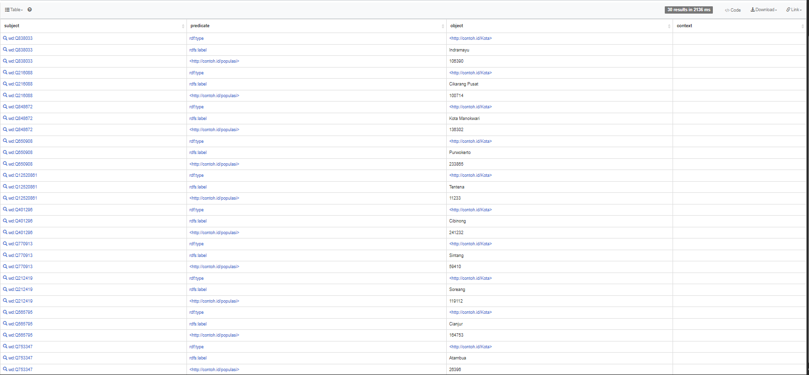
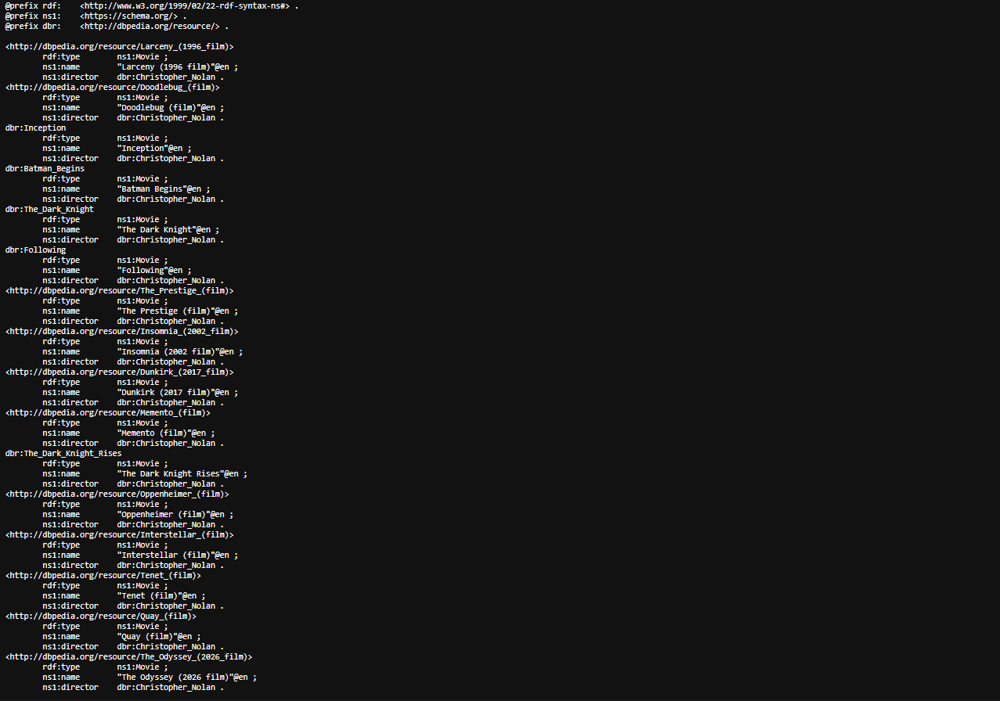
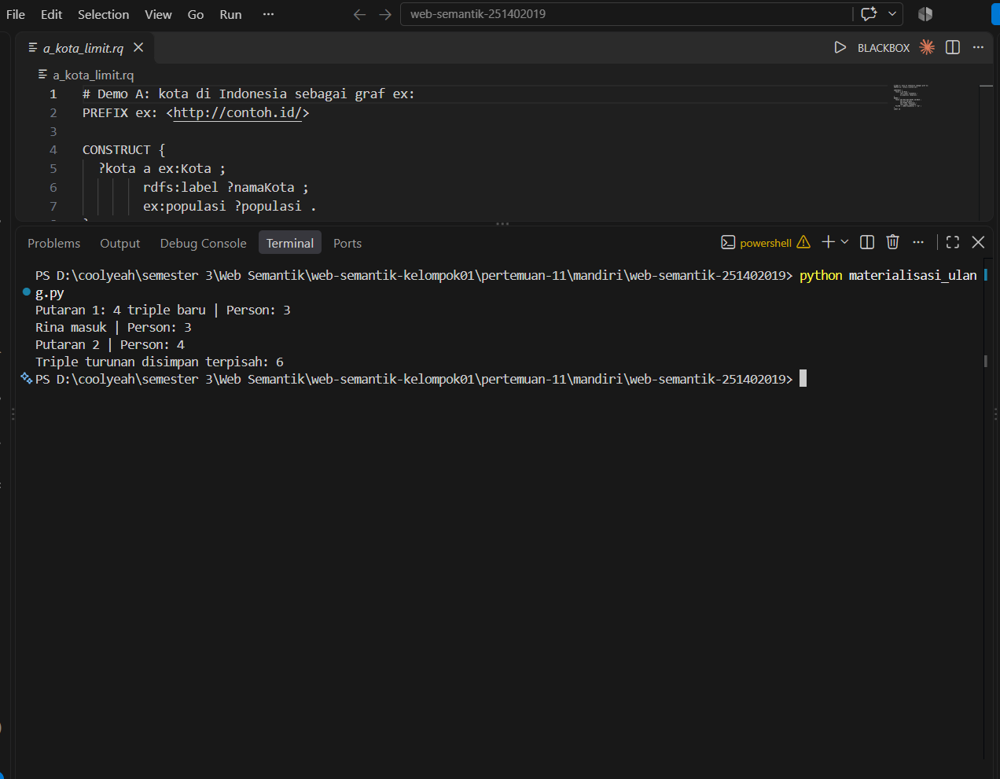

# Pertemuan 11 – CONSTRUCT, Jalur Properti, dan Materialisasi (Tugas Mandiri)

NIM: 251402019 · Semua angka di bawah berasal dari hasil run saya sendiri (12 November 2026). Wikidata dan DBpedia terus disunting dan urutan hasil tanpa `ORDER BY` tidak dijamin, sehingga angka di mesin lain bisa berbeda.

## Isi folder

| Berkas | Asal | Keterangan |
|---|---|---|
| `film.ttl`, `kota.ttl`, `kampus.ttl`, `q_demo_b.rq`, `demo_c.py`, `demo_d.py` | LMS | Data dan program demo |
| `a_kota_limit.rq` | soal (Bagian A) | CONSTRUCT kota Indonesia di Wikidata |
| `materialisasi_ulang.py` | soal (C2) | Materialisasi yang menyimpan triple turunan terpisah |
| `jalankan.py` | soal (D) | Menjalankan satu `.rq` pada satu `.ttl` |
| `rusak_a.rq`, `rusak_b.rq`, `rusak_c.rq` | soal (D) | Tiga query yang diam-diam salah |
| `perbaikan_a.rq`, `perbaikan_b.rq`, `perbaikan_c.rq` | saya | Versi yang sudah benar |
| `film_nolan.ttl` | keluaran `demo_c.py` | Graf dari DBpedia, disimpan sekali |
| `kampus_v4.ttl` | keluaran `demo_d.py` | Graf kampus dengan turunan bercampur |
| `kampus_turunan.ttl` | keluaran `materialisasi_ulang.py` | Hanya triple turunan |

---

## Bagian A – LIMIT membatasi solution, bukan triple

Query: [`a_kota_limit.rq`](a_kota_limit.rq), dijalankan di `https://query.wikidata.org`.



| Percobaan | Jumlah | Kota berbeda |
|---|---|---|
| CONSTRUCT `LIMIT 10` | **30 triple** | 10 |
| CONSTRUCT `LIMIT 30` | **90 triple** | 30 |
| `SELECT ?kota ?namaKota ?populasi` `LIMIT 10` | **10 baris** | 10 |

**Apakah hasil mencapai 30?** Ya. Template punya 3 pola (`?kota a ex:Kota`, `rdfs:label`, `ex:populasi`), jadi 10 solution mencetak paling banyak 10 × 3 = 30 triple. Pada run saya ketiga pola menghasilkan triple yang berbeda untuk setiap kota, karena setiap kota punya tepat satu label berbahasa `id` dan satu nilai populasi. Ketiga triple per kota itu tidak ada yang bertabrakan, sehingga tidak ada yang menyatu. Dengan `LIMIT 30` angkanya ikut naik menjadi 90 (30 × 3).

Angka bisa saja di bawah 30 pada data lain. Penyebabnya adalah pola template yang mencetak triple kembar. Dua solution untuk kota yang sama, misalnya kota dengan dua nilai populasi, akan mencetak `?kota a ex:Kota` dan `?kota rdfs:label ?namaKota` yang sama persis dua kali, dan RDF menggabungkannya menjadi satu. Itu tidak terjadi pada run saya.

Pada langkah 3, hasil SELECT juga 10 baris dengan 10 kota berbeda. Tetapi kesepuluh kotanya tidak sama dengan kesepuluh kota pada CONSTRUCT (hanya 4 yang beririsan, misalnya Jakarta/Q3630 dan Tual/Q18975), karena tanpa `ORDER BY` urutannya tidak dijamin.

---

## Bagian B – Demo B dan C: dari DBpedia ke Turtle

**B1.** `q_demo_b.rq` dijalankan di `https://dbpedia.org/sparql` dengan format hasil Turtle.



**B2.** `python demo_c.py` mencetak:

```
48 triple
Film tanpa tanggal: 16
```

48 triple = 16 film × 3 pola yang terikat (`a schema:Movie`, `schema:name`, `schema:director`). Seluruh graf disimpan sebagai `film_nolan.ttl`.

**Untuk film yang tidak punya `dbo:releaseDate`, triple mana yang tetap tercetak dan mana yang tidak? Mengapa tidak ada error?**
Tiga triple tetap tercetak: `?film a schema:Movie`, `schema:name ?judul`, dan `schema:director`. Triple `schema:datePublished ?rilis` tidak tercetak. `OPTIONAL` tidak membuang baris yang tidak punya pasangan, tetapi `?rilis` pada baris itu tidak terikat. Aturan CONSTRUCT-nya: pola template yang memuat variabel tak terikat dilewati begitu saja, tanpa error. Pada run saya ke-16 film Nolan di DBpedia tidak punya `dbo:releaseDate`, maka tidak ada satu pun triple `datePublished` (itu sebabnya 48 = 16 × 3 dan "Film tanpa tanggal" = 16). Untuk pembanding, `q_demo_b.rq` pada `film.ttl` lokal memberi 12 triple: Following 4 (satu tanggal), Memento 5 (dua tanggal, jadi dua triple `datePublished`), Insomnia 3 (tanpa tanggal).

**Matikan internet, lalu jalankan hanya `Q_TANPA_TANGGAL` pada `film_nolan.ttl`.** Hasilnya tetap `16`, karena berkas itu graf lokal dan rdflib tidak memerlukan jaringan sama sekali.

**Apa yang terjadi bila seluruh `demo_c.py` dijalankan ulang tanpa internet?** Saya mensimulasikannya dengan proxy yang mati. Program berhenti di `sp.queryAndConvert()` dengan `urllib.error.URLError`, sebelum baris `serialize`. Akibatnya `film_nolan.ttl` tidak tersentuh (hash berkas sebelum dan sesudah sama) dan baris yang membaca berkas lokal tidak pernah tercapai. Cara yang benar adalah memisahkan bagian yang mengunduh dari bagian yang meng-query lokal.

**Mengapa query kedua memakai `schema:Movie`, bukan `dbo:Film`?** Berkas `film_nolan.ttl` dibuat dari template CONSTRUCT Demo B yang mencetak `?film a schema:Movie`, bukan `dbo:Film`. Pola `WHERE` pada Demo B hanya memakai `dbo:Film` untuk mencari, dan tipe itu tidak ikut dicetak ke graf hasil. Saya cek langsung: pada `film_nolan.ttl`, query `?f a schema:Movie` mengembalikan 16 baris sedangkan `?f a dbo:Film` mengembalikan **0** baris. Query lokal harus memakai kosakata yang ada di berkas.

---

## Bagian C – Materialisasi dan masalah data baru

**C1.** `python demo_d.py`:

```
Sebelum: 0
Sesudah: 3
Ada Rina: 3
```

**Mengapa "Ada Rina" tetap 3, padahal Rina adalah `ex:DosenTetap` dan `ex:DosenTetap` turunan dari `foaf:Person`?**
`Q_ORANG` hanya mencari triple `?x a foaf:Person` yang benar-benar ada di graf. Materialisasi di `demo_d.py` hanya berjalan sekali, sebelum Rina masuk, sehingga Rina hanya punya fakta `ex:rina a ex:DosenTetap`. Kesimpulan `ex:rina a ex:Dosen` dan `ex:rina a foaf:Person` belum pernah dihitung, dan graf tidak menurunkannya sendiri. Hierarki `subClassOf` sudah ada di graf, tetapi mesin SPARQL tidak menerapkannya kecuali saya menuliskan jalur `rdfs:subClassOf*`.

**C2.** `python materialisasi_ulang.py`:

```
Putaran 1: 4 triple baru | Person: 3
Rina masuk | Person: 3
Putaran 2 | Person: 4
Triple turunan disimpan terpisah: 6
```



**Query `ATURAN` pada putaran 1 menghasilkan 7 triple, tetapi hanya 4 yang baru. Tiga triple lain apa, dan bagian jalur mana yang menyebabkannya?**
Tiga triple lain adalah tipe yang sudah tertulis di data asli: `ex:budi a ex:DosenTetap`, `ex:sari a ex:Dosen`, dan `ex:andi a ex:Mahasiswa`. Penyebabnya adalah tanda `*` pada `rdfs:subClassOf*`, yang berarti nol atau lebih langkah. Nol langkah mengembalikan kelas asli itu sendiri, sehingga setiap fakta tipe lama ikut diturunkan lagi. Total 3 (Budi) + 2 (Sari) + 2 (Andi) = 7, dikurangi 3 yang sudah ada, tersisa 4 triple baru: Budi `Dosen` dan `Person`, Sari `Person`, Andi `Person`. Pemeriksaan `if t not in g` pada fungsi `materialisasi` yang menyaring ketiganya agar tidak ikut tersimpan sebagai "baru".

**Mengapa berkas terpisah `kampus_turunan.ttl` berguna bila suatu hari `ex:Dosen` tidak lagi subkelas `foaf:Person`? Langkah apa yang tetap harus saya lakukan manual?**
Berkas itu hanya berisi triple hasil kesimpulan, jadi saya tahu persis mana yang boleh dibuang tanpa menyentuh data asli. Bila `ex:Dosen` tidak lagi turunan `foaf:Person`, triple turunan lama bisa diganti seluruhnya. Hal yang tetap manual: (1) memperbaiki taksonomi di `kampus.ttl`; (2) menghapus isi `kampus_turunan.ttl` dari graf produksi; (3) menjalankan ulang `ATURAN` pada graf yang sudah bersih; (4) menyimpan turunan baru. Program juga tidak bisa memberi tahu kapan taksonomi berubah, sehingga saya sendiri yang harus ingat melakukan semuanya, di sinilah reasoner Pertemuan 12 nanti menggantikan langkah manual ini.

---

## Bagian D – Diagnosis tiga CONSTRUCT yang diam-diam salah

Diagnosis dimulai dari angka: bandingkan jumlah triple yang keluar dengan jumlah yang masuk akal dari data.

| Query | Data | Hasil mesin | Target | Gejala pada tabel |
|---|---|---|---|---|
| `rusak_a.rq` | `film.ttl` | **0 triple** | 3 | Graf kosong, tanpa error |
| `rusak_b.rq` | `film.ttl` | **4 triple** | 3 | Dua nilai yang tampak sama |
| `rusak_c.rq` | `kota.ttl` | **0 triple** | 3 | Superkelas tidak ditemukan |

**`rusak_a.rq` – penyebab:** pada klausa `WHERE`, subjek ditulis `?f dbo:director …`, tetapi template di `CONSTRUCT` memakai `?film`, jadi `?film` tidak pernah terikat dan tidak ada triple yang tercetak. Bukti: `WHERE` yang sama dijalankan sebagai `SELECT *` memberi 3 baris (Following, Memento, Insomnia), jadi pola `WHERE` benar dan yang salah adalah nama variabel di template.
Perbaikan (`perbaikan_a.rq`): ubah `?f` menjadi `?film` pada baris `?f dbo:director dbr:Christopher_Nolan ;`. Hasil: 3 triple.

**`rusak_b.rq` – penyebab:** pada baris `?o foaf:name|rdfs:label|schema:name ?n .`, Christopher Nolan cocok dengan dua predikat sekaligus (`foaf:name` bernilai `"Christopher Nolan"` tanpa tag, dan `rdfs:label` bernilai `"Christopher Nolan"@en`), dan kedua literal itu dianggap dua nilai berbeda karena beda tag bahasa, sehingga tercetak dua triple `ex:nama` untuk satu orang.
Perbaikan (`perbaikan_b.rq`): tangkap nilai ke `?nama` lalu tambahkan `BIND ( STR(?nama) AS ?n )`. `STR()` membuang tag bahasa, kedua solution Nolan menjadi triple yang sama persis dan menyatu. Hasil: 3 triple, tepat satu `ex:nama` per orang.

**`rusak_c.rq` – penyebab:** pola `?x a ex:Permukiman .` hanya cocok dengan triple yang tipenya tertulis langsung sebagai `ex:Permukiman`, padahal di `kota.ttl` tidak ada satu pun yang bertipe itu; Medan, Surabaya, dan Tomok bertipe subkelasnya (`ex:Kota`, `ex:Desa`, dan seterusnya) tanpa jalur `rdfs:subClassOf*`.
Perbaikan (`perbaikan_c.rq`): ganti `?x a ex:Permukiman .` dengan `?x a/rdfs:subClassOf* ex:Permukiman .`. Hasil: 3 triple (Medan, Surabaya, Tomok).

---

## Bagian E – Etika endpoint dan diskusi tertulis

### E1. Etika endpoint

| # | Aturan | `a_kota_limit.rq` | `demo_c.py` |
|---|---|---|---|
| 1 | User-Agent bermakna | Tidak relevan: query dijalankan lewat antarmuka web, jadi header dikirim oleh browser. | Terpenuhi pada baris 11–12: `UA = "KelasWebSemantik/1.0 (…)"` lalu `SPARQLWrapper("https://dbpedia.org/sparql", agent=UA)`. Bagian dalam kurung berisi email kontak, sehingga admin endpoint bisa menghubungi bila ada masalah. |
| 2 | LIMIT saat eksplorasi | Terpenuhi pada baris 16: `LIMIT 10`. | Tidak ada `LIMIT`, tetapi hasilnya dibatasi oleh pola `dbo:director dbr:Christopher_Nolan` (16 solution), jadi aman. `LIMIT` tetap lebih baik pada eksplorasi. |
| 3 | Simpan, jangan ulangi | Tidak relevan untuk satu kali jalan di browser (percobaan `LIMIT 10`, `LIMIT 30`, dan `SELECT` masing-masing memang query berbeda). | Terpenuhi pada baris 15–17 dan 19: query dikirim satu kali, graf disimpan (`g.serialize("film_nolan.ttl", …)`), lalu `Graph().parse("film_nolan.ttl")` dipakai untuk query lokal tanpa internet. |
| 4 | Jangkar jalur | Terpenuhi pada baris 10: `?kota wdt:P31/wdt:P279* wd:Q515`, jalur `*` berujung pada IRI tertentu (`wd:Q515`), dan `wdt:P17 wd:Q252` ikut mempersempit. | Tidak relevan: `q_demo_b.rq` tidak memakai jalur `*` atau `+`. |

**Versi `a_kota_limit.rq` yang melanggar aturan 4 (jangan dijalankan):**

```sparql
# JANGAN DIJALANKAN - jalur * berangkat dari dua variabel
PREFIX ex: <http://contoh.id/>
CONSTRUCT {
  ?kota a ex:Kota ;
        rdfs:label ?namaKota ;
        ex:populasi ?populasi .
}
WHERE {
  ?kota wdt:P31/wdt:P279* ?jenis .      # ?kota dan ?jenis sama-sama variabel
  ?kota wdt:P17 wd:Q252 ;
        wdt:P1082 ?populasi ;
        rdfs:label ?namaKota .
  FILTER ( ?jenis = wd:Q515 )           # anchor baru dipasang SESUDAH jalur
  FILTER ( LANG(?namaKota) = "id" )
}
LIMIT 10
```

Pada versi ini `wd:Q515` tidak lagi menjadi ujung jalur, hanya disaring belakangan lewat `FILTER`. Mesin bisa menelusuri `wdt:P31/wdt:P279*` untuk setiap item yang punya `P31` di seluruh Wikidata, yaitu ratusan juta item, masing-masing dengan seluruh rantai kelas induknya, sebelum filter menyisakan segelintir kota. `LIMIT 10` tidak menolong, karena `LIMIT` membatasi solution akhir, bukan pekerjaan di tengah. Hasilnya beban besar bagi endpoint bersama dan hampir pasti timeout. Versi aslinya jauh lebih murah karena penelusuran mulai dari satu IRI yang sudah diketahui.

### E2. Diskusi

**1. Taksonomi berubah setahun setelah materialisasi, triple mana yang salah dan bagaimana menemukannya?**

Pada C1, `kampus_v4.ttl` berisi 13 triple: 9 triple asli ditambah 4 triple hasil materialisasi, semuanya tercampur dalam satu graf. Pada C2, `kampus_turunan.ttl` berisi 6 triple yang seluruhnya turunan. Misalkan setahun kemudian `ex:Dosen` tidak lagi `rdfs:subClassOf foaf:Person`. Saya mensimulasikannya dengan menjalankan ulang `ATURAN` pada data asli dengan taksonomi baru. Hasilnya hanya 3 triple turunan baru, dan 3 dari 6 triple lama tidak lagi bisa diturunkan: `ex:budi`, `ex:sari`, dan `ex:rina` bertipe `foaf:Person`. Ketiganya kini salah, sedangkan `ex:andi a foaf:Person` tetap benar lewat `ex:Mahasiswa`. Di `kampus_turunan.ttl` menemukannya mudah: cukup selisih antara berkas turunan lama dan hasil hitung ulang, tanpa menyentuh data asli. Di `kampus_v4.ttl` triple basi tidak bisa dikenali dari isinya, karena `ex:budi a foaf:Person` tampak sama dengan fakta yang diketik manual. Saya hanya bisa menemukannya dengan membandingkan terhadap `kampus.ttl` (13 − 9 = 4 triple tambahan) lalu menghitung ulang. Jadi berkas terpisah mengubah pembersihan menjadi satu langkah selisih, sedangkan graf campuran memaksa audit seluruh graf. Karena itu pada sistem produksi saya akan selalu menyimpan turunan secara terpisah dan mencatat versi taksonomi yang dipakai saat menghitungnya.

**2. Dashboard populasi kota dan penggabungan tiga sumber: SELECT atau CONSTRUCT?**

Untuk dashboard populasi saya memakai SELECT, sedangkan untuk menggabungkan data kota dari tiga sumber saya memakai CONSTRUCT. Dashboard butuh tabel angka, dan SELECT langsung memberi baris: pada Demo A, `SELECT` dengan `LIMIT 10` memberi 10 baris, satu per kota, sedangkan CONSTRUCT memberi 30 triple yang harus dipecah lagi. Tetapi SELECT tidak menyembunyikan data kembar. Di `kota.ttl`, Medan punya dua populasi (2435252 dan 2097610), sehingga `SELECT ?x ?p` memberi 3 baris untuk hanya 2 kota; bila dijumlahkan, Medan terhitung dua kali kecuali saya memilih satu nilai dengan `MAX` atau `SAMPLE`. Untuk penggabungan, CONSTRUCT lebih cocok karena keluarannya graf yang bisa disimpan dan digabung dengan graf sumber lain, dan triple identik menyatu otomatis. Namun `rusak_b.rq` memperingatkan: nama Nolan muncul sebagai `"Christopher Nolan"` dan `"Christopher Nolan"@en`, sehingga 4 triple padahal targetnya 3, karena beda tag bahasa membuat dua nilai yang tampak sama dianggap berbeda. Setelah `STR()` hasilnya 3 triple. Jadi alur saya: CONSTRUCT untuk menormalkan dan menggabungkan sumber ke satu graf, lalu SELECT dengan agregasi untuk dashboard.

### Cek diri dengan ringkasan pertemuan

1. **CONSTRUCT mencetak template sekali per solution dan menggabungkan triple kembar.** Bagian A: 10 solution × 3 pola = 30 triple. Bagian D, `perbaikan_b.rq`: `SELECT` menghasilkan 4 baris, tetapi setelah `STR()` dua baris Nolan identik, sehingga CONSTRUCT hanya mencetak 3 triple.
2. **Triple dengan variabel tak terikat tidak dicetak, tanpa error.** Bagian D, `rusak_a.rq`: `?film` tidak terikat, hasil 0 triple tanpa pesan apa pun. Bagian B: tidak ada satu pun triple `datePublished` untuk 16 film di DBpedia (48 triple = 16 × 3), juga tanpa error.
3. **UNION, jalur `|`, dan VALUES menyatukan predikat berbeda.** Bagian D, `rusak_b.rq`: jalur `foaf:name|rdfs:label|schema:name` menyatukan tiga predikat ke satu `?n`, dan `VALUES` membatasi tiga orang. Versi `UNION` tiga cabang yang saya uji menghasilkan 4 baris yang persis sama dengan jalur `|`.
4. **Jalur `+` dan `*` menelusuri hierarki tanpa menyebut perantara.** Bagian D, `rusak_c.rq`: tanpa jalur 0 triple, dengan `a/rdfs:subClassOf*` jadi 3 triple, padahal Medan baru sampai `ex:Permukiman` lewat `ex:KotaMetropolitan` → `ex:Kota` → `ex:Permukiman`. Bagian A: `wdt:P31/wdt:P279* wd:Q515` pada Wikidata.
5. **Materialisasi menyimpan kesimpulan, tetapi harus dihitung ulang.** Bagian C1: "Ada Rina" tetap 3. Bagian C2: setelah `materialisasi` dijalankan ulang, `Person` naik dari 3 menjadi 4.

---

## Catatan

- `film.ttl`, `kota.ttl`, dan `kampus.ttl` adalah data rekaan dari LMS untuk latihan, bukan isi DBpedia atau Wikidata yang sebenarnya.
- Tangkapan layar ada di folder `screenshots/`: `a-limit10.png` (Wikidata), `b-dbpedia.png` (DBpedia), dan `c-materialisasi.png` (terminal).
